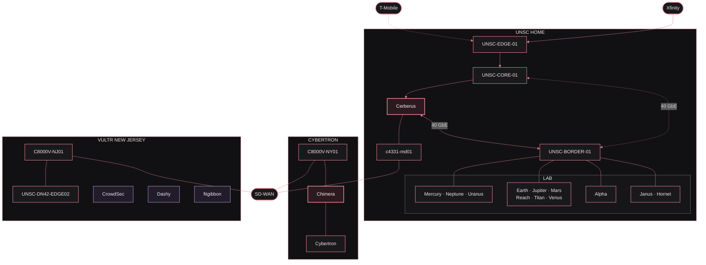

# UNSC Homelab

UNSC is my multi-site infrastructure homelab, built around systems, storage, networking, and virtualization. It brings together enterprise hardware, virtualized platforms, and cloud services for hands-on engineering and experimentation.

## Architecture

*Core to Border and Border to Cerberus are 40 GbE physical links. Cerberus is the routed security boundary for protected lab networks.*

## Hardware & Platforms

| Category | Platforms |
| --- | --- |
| Networking | Cisco Nexus, Cisco ISR/C8000V, MikroTik, UniFi |
| Security | Palo Alto PA-5220, VM-Series |
| Compute | Dell PowerEdge, Cisco UCS |
| Virtualization | VMware vSphere, Microsoft Hyper-V, EVE-NG |
| Storage | TrueNAS SCALE, QNAP, Windows Storage Spaces |
| Services | Active Directory, DNS, PKI, Veeam, Graylog, CrowdSec, Dashy |

## Related Projects

- [EVE-NG Automation](https://github.com/ksmoove21/eve-ng-automation)
- [UNSC DN42](https://github.com/ksmoove21/unsc-dn42)
