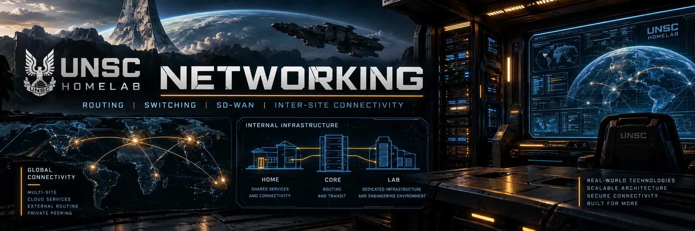

  

# Maryland | Home Base

[← Networking](../README.md) | [Architecture](../architecture/README.md) | [WAN](../wan/README.md)

Maryland is the physical foundation of UNSC: the shared Internet edge, protected lab, high-speed data plane, and home-hosted services all meet here. Its design separates **shared connectivity** from the **lab's routed security boundary**.

## Explore Home Base

<table>
<tr><td>
<h3><a href="cerberus/README.md">Cerberus: Routing & Security Domains</a></h3>

Palo Alto virtual routers, internal ASNs, BGP peerings, and the lab's routing boundaries.

</td></tr>
</table>

## Network Architecture

| Component | Role in the design |
| --- | --- |
| **UNSC-EDGE-01** | Shared household and lab Internet edge, with Xfinity and T-Mobile connectivity |
| **UNSC-CORE-01** | MikroTik CRS326 bringing household and lab infrastructure together at a common aggregation point |
| **Cerberus** | PA-5220 providing the lab's routed security, inter-domain policy, and BGP boundaries |
| **UNSC-BORDER-01** | Nexus 92160YC-X concentrating lab compute, storage, and firewall-facing traffic |
| **c4331-md01** | Catalyst SD-WAN edge for intersite connectivity and Hurricane Electric IPv6 transport |

## Why This Layout?

The UDM-SE's two 10 GbE SFP+ ports provide one high-speed WAN connection and one high-speed LAN connection. The MikroTik core distributes that LAN handoff across the shared home and lab infrastructure.

Behind the shared aggregation layer, **Cerberus defines where the protected lab begins**. Its virtual routers separate production, personal, experimental, management, WAN, remote-access, and DN42 traffic.

The Nexus provides the server/storage data plane. ESXi hosts connect at dual 10 GbE, while TrueNAS has dual 25 GbE links. **Core ↔ Border and Border ↔ Cerberus run at 40 GbE**, preserving port capacity and supporting concurrent storage and backup activity.

## Connected Infrastructure

Home Base hosts the vSphere compute and EVE-NG clusters, Alpha/TrueNAS storage, Janus/Hyper-V, Hornet backup and file services, and supporting identity, monitoring, and administration services.

[Explore Cerberus](cerberus/README.md) · [View the overall topology](../../README.md#architecture) · [Homelab Projects](https://github.com/ksmoove21/homelab-projects)
