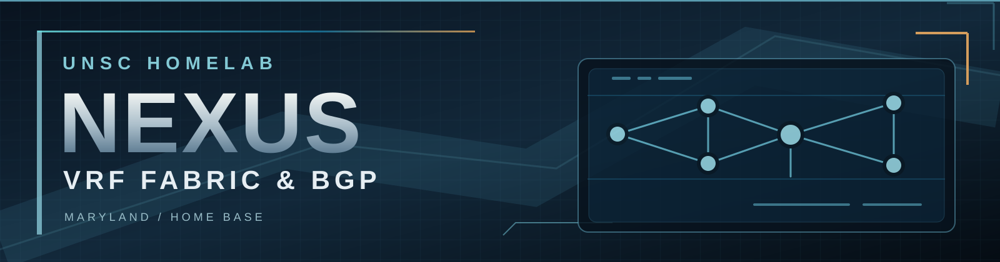

  

# UNSC-BORDER-01 | Nexus VRF Fabric & BGP

[← Maryland | Home Base](../README.md) | [Cerberus](../cerberus/README.md) | [Networking](../../README.md)

The **Cisco Nexus 92160YC-X** is the high-speed switching and segmented routing fabric for UNSC's home lab. It connects the physical compute hosts, TrueNAS storage, and Cerberus while maintaining separate routing instances for individual infrastructure services.

## At a Glance

| VRF contexts | BlueLine service VRFs | Core and firewall uplinks |
| :---: | :---: | :---: |
| **21** | **17** | **40 GbE each** |

## Routing Design

Nexus uses dedicated **VRFs** for identity, file services, backups, monitoring, virtualization, storage management, and other workloads. Each service retains an independent route table.

These VRFs are associated with **VXLAN EVPN Layer 3 VNIs** and separate routed transit interfaces toward Cerberus. BGP distributes reachability through the relevant routing contexts.

The [Security Architecture](../../../security/README.md) documents why the service VRFs map to individual firewall zones and how inter-service traffic is controlled.

The physical design matches the workload demand:

- **ESXi:** dual 10 GbE host connectivity.
- **TrueNAS:** dual 25 GbE storage connectivity.
- **UNSC-CORE-01 ↔ UNSC-BORDER-01:** 40 GbE.
- **UNSC-BORDER-01 ↔ Cerberus:** 40 GbE.

The larger uplinks preserve 10 GbE port capacity and accommodate simultaneous compute, storage, and backup traffic.

## VRF Inventory

### BlueLine | Shared Infrastructure

The production/service environment is divided into **17 dedicated BlueLine VRFs**.

| VRF | Function | Layer 3 VNI |
| --- | --- | ---: |
| `blueline_aaa` | Network authentication and AAA | 30037 |
| `blueline_ai` | AI workloads | 30045 |
| `blueline_dhcp` | DHCP services | 30030 |
| `blueline_docker` | Container workloads | 30044 |
| `blueline_esxi` | VMware ESXi management | 30050 |
| `blueline_file` | File services | 30031 |
| `blueline_hv` | Hyper-V services | 30038 |
| `blueline_id` | Identity services | 30033 |
| `blueline_nms` | Network management and monitoring | 30040 |
| `blueline_openstack` | OpenStack workloads | 30042 |
| `blueline_pihole` | DNS / Pi-hole | 30041 |
| `blueline_proxmox` | Proxmox workloads | 30043 |
| `blueline_prtg` | PRTG monitoring | 30034 |
| `blueline_smtp` | SMTP relay | 30035 |
| `blueline_sql` | SQL services | 30036 |
| `blueline_storage` | Storage management | 30055 |
| `blueline_veeam` | Backup services | 30032 |

### Other Routing Domains

| VRF | Purpose | Layer 3 VNI |
| --- | --- | ---: |
| `greenline_pc` | Personal / Windows environment | 10012 |
| `redline_lab` | Experimental lab networks | 20003 |
| `management` | Nexus management routing | — |
| `test_vrf` | Isolated testing | 50000 |

## BGP Relationships

The Nexus uses **BGP AS65301**. Its service VRFs establish separate BGP relationships with the corresponding virtual-router domains on **Cerberus**.

| Nexus VRF domain | Nexus ASN | Cerberus virtual router | Cerberus ASN |
| --- | --- | --- | --- |
| BlueLine service VRFs | **65301** | **Blueline** | **65300** |
| `greenline_pc` | **65301** | **Greenline** | **65100** |
| `redline_lab` | **65301** | **Redline** | **65200** |

The Nexus configuration includes BGP neighbor definitions for **13 BlueLine VRFs**, with IPv4 and IPv6 peerings where configured. The GreenLine and RedLine VRFs each have IPv4 and IPv6 firewall neighbors.

The `greenline_pc` VRF also contains an additional peer in **AS66542**, while `test_vrf` has a separate lab peer in **AS65500**.

## Routing Relationships

**Nexus** provides the high-speed switching fabric, independent VRF route tables, VXLAN EVPN connectivity, and local gateway interfaces.

**Cerberus** receives the relevant VRF BGP peerings and provides routed connectivity to the shared edge and other UNSC routing domains.

[Explore service-level security policy](../../../security/cerberus/README.md).

[Explore Cerberus](../cerberus/README.md) · [← Maryland | Home Base](../README.md) · [UNSC Topology](../../../README.md#architecture)
