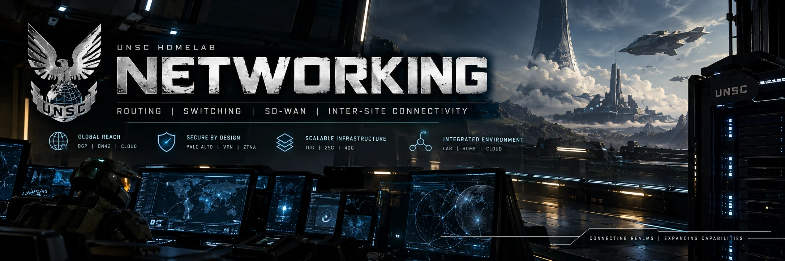

  

# WAN & External Routing

[← Networking](../README.md) | [UNSC Homelab](../../README.md) | [Architecture & Design Decisions](../architecture/README.md)

UNSC extends beyond its home network through independent remote hosting, public address resources, and routed connectivity. **UNSC Net** is the public autonomous-system identity behind this growing environment, while Catalyst SD-WAN and external routing services connect home infrastructure with Cybertron and Vultr New Jersey.

## WAN Connectivity

| Network | Use |
| --- | --- |
| **Xfinity** | Primary household and lab Internet transport |
| **T-Mobile 5G** | Backup Internet transport |
| **Free Range Cloud** | Public IPv4 prefixes routed over WireGuard to the home edge |
| **Hurricane Electric** | IPv6 tunnel-based reachability through the Maryland ISR and Cerberus |
| **MyInterServer / Cybertron** | Dedicated physical ESXi host, independent public Internet attachment, and Catalyst SD-WAN connectivity |
| **Vultr New Jersey** | Cloud site with independent global IPv6 routing, DN42 edge, and SD-WAN integration |
| **DN42** | External overlay routing and service-provider experimentation |

## Routing Identity

| ASN | Scope |
| --- | --- |
| **AS218293** | **UNSC Net**, public Internet autonomous system |
| **AS4242421995** | Registered DN42 autonomous system for the separate DN42 overlay |

## Public IPv4 Addressing

UNSC currently uses two **Free Range Cloud /29** blocks:

| Prefix | Architectural role |
| --- | --- |
| **142.202.91.216/29** | Public DMZ segment connected at the UDM-SE edge |
| **142.202.91.96/29** | Public block routed onward from the UDM-SE toward Cerberus |

Free Range Cloud provides a **routed public IPv4 upstream over WireGuard**. Public source addresses are preserved where intended, and inbound access remains subject to edge and firewall policy.

## IPv6 Networks

| Prefix | Context |
| --- | --- |
| **2602:fed2:719c::/48** | Global IPv6 allocation, routed and advertised via the Vultr New Jersey upstream |
| **fd16:2e38:95d2::/48** | Registered DN42 IPv6 allocation, used within the DN42 routing domain |
| **2001:470:e15a::/48** | Hurricane Electric routed IPv6 space used by the home-side IPv6 environment |

Global IPv6 and DN42 addressing serve distinct routing domains. Hurricane Electric provides the home-side routed IPv6 prefix.

At home, the HE 6in4 path terminates on **c4331-md01** and exchanges IPv6 reachability through Cerberus. Vultr New Jersey provides independent global IPv6 routing.

## Inter-Site Routing

**Catalyst SD-WAN** connects three UNSC environments with distinct infrastructure roles:

| Location | Connectivity & Infrastructure |
| --- | --- |
| **[Maryland \| Home Base](../home-base/README.md)** | Shared residential edge, Cerberus security boundary, on-premises compute, and ISR4331 SD-WAN edge |
| **[Cybertron](../cybertron/README.md)** | MyInterServer dedicated ESXi host, Chimera, and a Catalyst 8000V SD-WAN edge |
| **[Vultr Cloud](../vultr-cloud/README.md)** | New Jersey cloud routing, DN42 edge, CrowdSec, Dashy, and remote-access services |

Each site owns its local routing and security responsibilities while using the SD-WAN fabric for selected intersite reachability.

## Externally Consumable Services

Selected services are published and reached through approved public and overlay paths, with UDM-SE and Palo Alto policies governing access.

For the external routing and enclave design, see [UNSC DN42](https://github.com/ksmoove21/unsc-dn42).

[Back to Networking](../README.md) · [View Network Architecture](../architecture/README.md)
