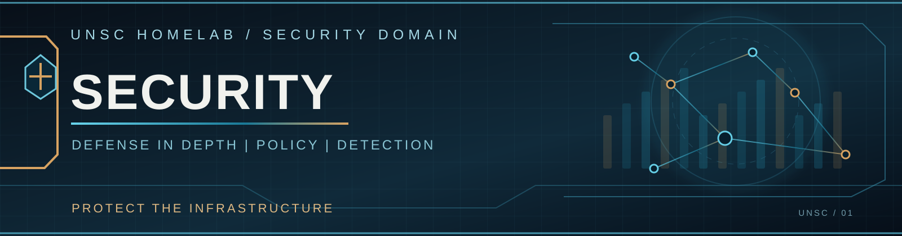

  

# Security

[← UNSC Homelab](../README.md) | [Networking](../networking/README.md)

UNSC uses layered security that follows the structure of the network: individual infrastructure services, larger routed domains, and Internet-facing traffic each have their own inspection and policy boundaries.

The architecture brings together **Palo Alto firewalls, UniFi zone-based policy and intrusion prevention, and centrally distributed threat intelligence**.

## Explore Security

<table>
<tr>
<td width="50%" valign="top">
<h3><a href="cerberus/README.md">Cerberus | Service Segmentation</a></h3>

How Nexus VRFs map to Palo Alto zones and why traffic between services passes through firewall policy.

</td>
<td width="50%" valign="top">
<h3><a href="udm-se/README.md">UNSC-EDGE-01 | Domain & Edge Security</a></h3>

How the Dream Machine maps BlueLine, RedLine, and GreenLine to zones while providing IPS and perimeter controls.

</td>
</tr>
<tr>
<td colspan="2" valign="top">
<h3><a href="threat-intelligence/README.md">Threat Intelligence | CrowdSec</a></h3>

UniFi IPS, Palo Alto telemetry, Network Optimizer analysis, centralized detection, and distributed blocklists.

</td>
</tr>
</table>

## Security Layers

| Layer | Platform | Purpose |
| --- | --- | --- |
| **Service-level policy** | Cerberus / Palo Alto PA-5220 | Dedicated zones for service VRFs and application access |
| **Domain & edge policy** | UDM-SE / UniFi Network | Larger BlueLine, RedLine, GreenLine, WAN, VPN, and other security zones |
| **Intrusion prevention** | UniFi IPS | Network intrusion detection and blocking on selected domains |
| **Cross-site security** | Chimera / Palo Alto VM-Series | Dedicated security boundary for Cybertron at MyInterServer |
| **Threat intelligence** | CrowdSec / Vultr New Jersey | Detection, correlation, and threat-list distribution across the sites |

The [Networking documentation](../networking/README.md) covers route exchange, ASNs, VRFs, and the physical network. This section explains how traffic is **authorized, inspected, and protected** after a route becomes available.

[Home Base](../networking/home-base/README.md) · [Cybertron](../networking/cybertron/README.md) · [Vultr Cloud](../networking/vultr-cloud/README.md)
