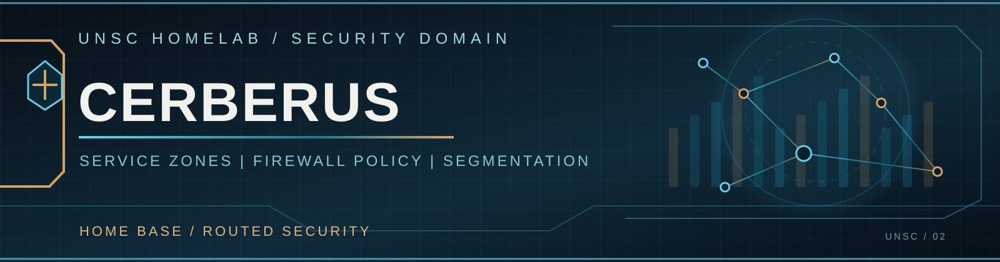

  

# Cerberus | Service-Level Segmentation

[← Security](../README.md) | [Nexus Routing](../../networking/home-base/nexus/README.md) | [Home Base](../../networking/home-base/README.md)

**Cerberus**, the Palo Alto PA-5220, enforces security policy for the protected lab. The network is deliberately segmented into service-specific Nexus VRFs, each associated with a corresponding **Palo Alto security zone**.

## Why Individual Service Zones?

Identity, file services, databases, virtualization, backup, and monitoring are all legitimate infrastructure workloads. Their shared BlueLine classification does not make them one trust zone.

UNSC separates those workloads into individual routed service VRFs on Nexus, then carries each service toward its matching firewall zone on Cerberus. That allows policies to distinguish source and destination services with more precision than a single BlueLine-wide rule.

**Example:** Access from an identity-service workload to a SQL workload is evaluated using the corresponding source and destination zones, applications, and permitted services.

## Routing Domains and Security Zones

| Routing layer | Security treatment |
| --- | --- |
| **Nexus service VRFs** | Individual infrastructure services have distinct routing tables and Palo Alto zones |
| **Cerberus Blueline VR** | Multiple BlueLine services share a broader routing domain while retaining zone-specific policy |
| **Cerberus Greenline / Redline** | Personal and experimental traffic remain in their respective routed domains |
| **Mgmt, Blackline, WAN, DN42** | Dedicated management, remote-access, external, and overlay security contexts |

Cerberus uses seven Palo Alto virtual routers: **Blueline, Greenline, Redline, Mgmt, Blackline, WAN, and DN42**. The security-zone structure provides the finer application and service boundaries inside those routed contexts.

## Policy Model

Traffic crossing a service boundary is evaluated against an explicit zone-based rulebase. UNSC uses allow rules for required application flows and a logged default drop for unmatched inter-zone traffic.

Cerberus also applies security inspection on permitted paths and provides separate policy boundaries for Internet egress, remote access, public services, and the DN42 enclave.

## Relationship to the Dream Machine

Individual service policy is owned by **Cerberus**. The **UDM-SE** represents the larger BlueLine, RedLine, and GreenLine domains as UniFi security zones at the shared edge.

That creates two distinct levels of policy: **service-level segmentation within the lab** and **domain-level classification at the shared edge**. The UDM's policy for selected lab-domain paths is deliberately permissive, allowing Cerberus to remain the primary application-access enforcement point.

[Explore UniFi Edge Security](../udm-se/README.md) · [Nexus VRF & BGP Architecture](../../networking/home-base/nexus/README.md)
