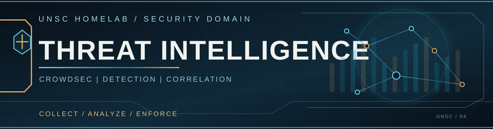

  

# Threat Intelligence | CrowdSec

[← Security](../README.md) | [UniFi Edge](../udm-se/README.md) | [Vultr Cloud](../../networking/vultr-cloud/README.md)

UNSC centralizes threat detection and distribution through **CrowdSec** hosted at **Vultr New Jersey**. It brings together security signals from different locations and products into one coordinated decision and threat-feed architecture.

## Detection & Correlation

| Source | Contribution |
| --- | --- |
| **UNSC-EDGE-01 / UniFi IPS** | Blocked high-severity intrusion events and edge telemetry |
| **Cerberus / PAN-OS** | Home Base traffic and ingress-security events |
| **Chimera / PAN-OS** | Cybertron traffic and ingress-security events |
| **UniFi Network Optimizer** | Historical traffic analysis and correlated threat patterns |
| **CrowdSec** | Detection scenarios, local decisions, community intelligence, and distribution |

The Network Optimizer adds context from traffic history, while direct IPS and firewall events supply additional evidence for CrowdSec's detection and correlation workflows.

## Distribution Across UNSC

CrowdSec publishes a shared threat feed consumed by:

- **Cerberus**, through Palo Alto external dynamic lists and security policy.
- **Chimera**, using the corresponding PAN-OS threat-list enforcement.
- **UNSC-EDGE-01**, through UniFi dynamic IPv4 lists and firewall rules.

The UDM-SE uses a combined list alongside a dedicated local-decision list. Graylog receives centralized UniFi telemetry through the logging relay, supporting search and investigation alongside detection.

## Design Intent

This design lets security events at one boundary contribute to visibility across the rest of UNSC. Individual firewalls continue enforcing their local policies, while CrowdSec supplies shared context and block decisions.

[Explore Cerberus](../cerberus/README.md) · [Explore UniFi IPS](../udm-se/README.md)
