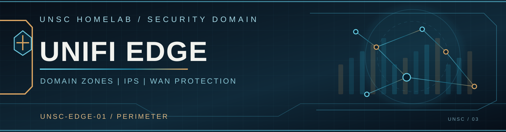

  

# UNSC-EDGE-01 | Domain & Edge Security

[← Security](../README.md) | [Cerberus](../cerberus/README.md) | [Networking](../../networking/README.md)

The UniFi Dream Machine Special Edition is the shared edge for household and lab connectivity. In addition to its WAN and routing functions, **UNSC-EDGE-01** provides zone-based policy enforcement, intrusion prevention, filtering, and integration with centralized threat intelligence.

## Domain-Level Zones

The UDM-SE recognizes the major protected-lab domains through corresponding UniFi firewall zones:

| UNSC domain | UniFi zone |
| --- | --- |
| **BlueLine** | BlueLine |
| **RedLine** | RedLine |
| **GreenLine** | GreenLine |

Additional UniFi zones cover **External, Internal, DMZ, VPN, Guest, IoT, and Management**.

These zones establish the broader domain-level policy matrix. Cerberus handles the detailed service-to-service policy inside the protected lab, while the Dream Machine owns edge policy and its locally defined security zones.

## Intrusion Prevention

UNSC uses **UniFi CyberSecure intrusion prevention** in addition to Palo Alto firewall inspection.

The deployed IPS scope includes **BlueLine, GreenLine, and DMZ**, with the configured protection categories enabled and a specific Cybertron-source exception. This covers traffic across selected shared and lab-facing domains.

UniFi's content filtering and the environment's upstream DNS filtering provide complementary web and domain controls.

## External Threat Blocking

The UDM-SE also consumes centrally published **CrowdSec** dynamic IP lists. Its security rules use the combined master feed and an additional locally sourced list to block selected hostile traffic.

UniFi IPS produces security detections that are also collected by CrowdSec, allowing the edge gateway to act as both a protection point and a contributing sensor.

## Why the Two Enforcement Layers?

Cerberus is optimized around **granular lab segmentation**, while the UDM-SE handles **shared edge zones, Internet admission, and IPS inspection**. Their responsibilities complement one another without repeating the entire service-policy matrix.

[Explore CrowdSec](../threat-intelligence/README.md) · [Home Base](../../networking/home-base/README.md)
